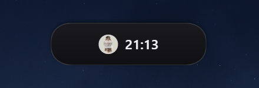
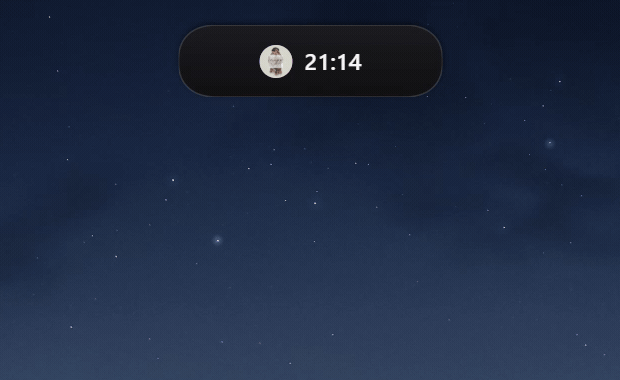
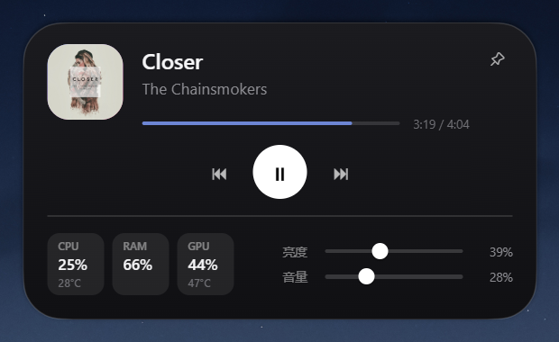

# Dynamic Island for Windows

一个面向 Windows 桌面的轻量「灵动岛」。第一阶段以原生 WPF 验证视觉质感与动画；第二阶段迁移到 Vue 3 + TypeScript + Tauri 2 + Rust，扩展系统监控与快捷控制能力，同时保持收起态接近零后台开销。

## 界面预览







## 快速入门

> 普通用户只需要三步：下载安装包、双击安装、灵动岛就会出现在屏幕顶部。

### 系统要求

- Windows 10 版本 2004（Build 19041）及以上，或 Windows 11。
- 安装与运行不需要管理员权限，也不需要 Node.js、Rust 或 Visual Studio。
- 支持多显示器与系统缩放，窗口居中于启动时的主显示器，命中区域会按当前 DPI 换算。
- CPU、内存和音量开箱即用；GPU 数据依赖 NVIDIA NVML，非 NVIDIA 显卡会回退为 `0%`。
- 亮度控制依赖笔记本内置屏的 `WmiMonitorBrightness` 接口，部分台式机与外接显示器不可用。

### 1. 下载安装包

1. 打开 [Releases](https://github.com/Hayden0226/Dynamic_Island_for_Windows/releases/latest) 页面。
2. 在最新版本的 `Assets` 中下载 `Dynamic-Island-2.0.2-Setup.exe`。
3. 也可以直接下载 2.0.2：[Dynamic-Island-2.0.2-Setup.exe](https://github.com/Hayden0226/Dynamic_Island_for_Windows/releases/download/v2.0.2/Dynamic-Island-2.0.2-Setup.exe)。

安装包大小约 `1.95 MiB`，适用于 64 位 Windows。

可选校验：在下载目录打开 PowerShell，执行：

```powershell
Get-FileHash .\Dynamic-Island-2.0.2-Setup.exe -Algorithm SHA256
```

2.0.2 的 SHA256 应为：

```text
53C74C8E0AAE3CBE7CAF8FBE69907262BE32E10725C3CD51039446BE20E7BB2C
```

### 2. 安装

1. 双击下载好的安装包。
2. 安装程序默认按当前用户安装，不需要管理员权限；默认目录为 `%LOCALAPPDATA%\Dynamic Island`。
3. 按向导完成安装，安装结束后程序会自动启动。
4. 安装程序会创建桌面快捷方式与开始菜单项，并把灵动岛放入系统托盘。
5. 首次运行默认开启「开机自启」，下次登录 Windows 时无需手动启动。

> 安装包尚未做代码签名。如果 Windows SmartScreen 提示「Windows 已保护你的电脑」，点击「更多信息」→「仍要运行」即可。

### 3. 首次启动

安装完成后，灵动岛会出现在主显示器顶部中央，并保持置顶：

- 没有媒体播放时，收起态只显示时间，尺寸为 `104 x 48`。
- 有媒体播放时，收起态显示封面与时间，尺寸为 `176 x 48`。
- 鼠标进入可见胶囊后展开；无媒体时使用 `380 x 112` 紧凑面板，有媒体时使用 `380 x 220` 完整面板。
- 窗口透明区域不会拦截鼠标，也不会挡住下方窗口的点击。

如果启动后没有看到灵动岛：

1. 左键单击系统托盘中的灵动岛图标，重新唤出窗口。
2. 如果托盘图标被折叠，点击任务栏右下角的 `^` 展开隐藏图标区。
3. 仍然没有显示时，从开始菜单重新打开 Dynamic Island；单实例机制只会唤出已有窗口。

### 4. 日常操作

| 操作 | 效果 |
| --- | --- |
| 鼠标进入 | 展开面板 |
| 鼠标离开 | 约 140 ms 后自动收起 |
| 点击图钉 | 保持展开，忽略自动收起 |
| 播放 / 暂停按钮 | 控制 Windows 全局媒体会话 |
| 上一首 / 下一首 | 切换当前媒体会话的曲目 |
| 拖动亮度滑块 | 调整内置屏亮度 |
| 拖动音量滑块 | 调整系统输出音量 |
| 浏览系统状态 | 查看 CPU、内存、GPU 占用与可用温度 |

说明：

- 媒体信息来自 Windows 全局媒体会话，支持 Spotify、Edge、Chrome、系统播放器等常见来源。
- 若播放器没有向系统暴露媒体会话，封面、标题与控制按钮不会出现。
- GPU 温度需要 NVIDIA 显卡与可用的 NVML 驱动；其他显卡只显示占用回退值。
- 台式机外接显示器可能不支持亮度控制，此时滑块不会生效。
- 没有媒体播放时不会显示默认封面，展开态只保留系统状态与快捷控制。

### 5. 开机自启与退出

- 默认随 Windows 登录自动启动。
- 右键单击托盘图标，可勾选或取消「开机自启」，设置立即生效。
- 左键单击托盘图标：重新显示灵动岛。
- 右键单击托盘图标 →「退出」：完全退出程序。

灵动岛不显示任务栏按钮，日常退出请使用托盘菜单。

### 6. 更新

1. 右键托盘图标，先退出正在运行的旧版本。
2. 打开 [Releases](https://github.com/Hayden0226/Dynamic_Island_for_Windows/releases/latest) 下载新版本安装包并覆盖安装。
3. 安装目录、快捷方式和开机自启设置会保留，新版本会自动启动。
4. 如果开机自启仍指向旧路径，退出后在托盘菜单重新勾选一次「开机自启」即可。

### 7. 卸载

1. 打开 Windows「设置 → 应用 → 已安装的应用」。
2. 找到 Dynamic Island，选择「卸载」。
3. 按提示完成卸载。

如果卸载后任务管理器仍显示失效的开机启动项，可在「任务管理器 → 启动应用」中将其禁用。

### 8. 常见问题

**安装时提示未知发布者怎么办？**

安装包尚未做代码签名，确认文件名和 SHA256 无误后，选择「更多信息」→「仍要运行」即可。

**为什么没有显示歌曲封面和标题？**

当前播放器没有向 Windows 暴露全局媒体会话。换用 Edge、Chrome、Spotify 或系统播放器通常可以正常显示。

**为什么 GPU 温度是空的？**

GPU 温度依赖 NVIDIA NVML。非 NVIDIA 显卡或驱动不可用时，只显示 GPU 占用。

**为什么亮度滑块没有效果？**

亮度控制依赖 `WmiMonitorBrightness`，台式机外接显示器、部分驱动或 HDR 模式可能不支持。

**为什么灵动岛挡不住下方窗口的鼠标？**

这是预期行为。窗口命中区域会跟随可见胶囊与面板收缩，透明区域全部穿透到底层窗口。

**重复双击图标会打开多个灵动岛吗？**

不会。程序使用单实例机制，重复启动只会唤出已有窗口。

### 9. 从源码运行

开发、调试与自行构建请参考下方的「构建与运行」章节。

## 当前版本（第二阶段 · Tauri）

### 能力

- `176 x 48` 媒体态胶囊 / `104 x 48` 无媒体胶囊，无媒体时只显示时间。
- `380 x 220` 媒体展开态 / `380 x 112` 无媒体紧凑展开态。
- 无媒体时不渲染默认封面，展开态只保留 CPU、RAM、GPU、亮度与音量。
- 系统状态区：CPU（占用 + 温度）、RAM（占用）、GPU（占用 + 温度）。
- 快捷控制：亮度滑块与音量滑块，直接读写系统真实值。
- 固定 `24 px` 的连续曲率圆角（`CornerSmoothing = 0.6`），收起与展开共用同一套几何，动画过程中圆角半径不变。
- 媒体会话：封面、标题、歌手与播放进度，支持上一首 / 播放暂停 / 下一首。
- 图钉保持展开、减少动态效果与通知聚合。

### 交互

| 操作 | 行为 |
| --- | --- |
| 鼠标进入 | 仅在可见胶囊/面板范围内触发展开 |
| 窗口命中区域 | 随胶囊/面板尺寸同步收缩，透明区域不会挡住下方窗口 |
| 鼠标离开 | 延迟约 140 ms 后收起 |
| 点击图钉 | 保持展开，忽略自动收起 |
| 拖动滑块 | 立即回写本地状态，并调用系统接口同步 |

### 动画系统

所有结构动画由 `src/core/animator.ts` 统一调度，尺寸、内容缩放、透明度与位移沿同一条时间线推进，不做无意义的弹跳。

| 动画 | 时长 |
| --- | --- |
| 展开尺寸 | 240 ms，无过冲 S 形缓动 |
| 收起触发 | 鼠标离开 140 ms 后开始 |
| 收起尺寸 | 260 ms，无过冲 S 形缓动 |
| 内容显现 | 与展开同步放大，自上而下淡入，约 180 ms |
| 收起内容退场 | 约 78 ms 淡出，再继续收缩表面 |

### 技术栈与目录

```text
island-app/
  src/                    Vue 3 + TypeScript 界面、动画、状态与 IPC
    components/           灵动岛表面与交互控件
    core/                 动画器、缓动、squircle 几何、指标与 IPC
    store/                全局状态与事件订阅
  src-tauri/              Tauri 2 + Rust 宿主
    src/lib.rs            窗口管理、媒体会话、系统数据、亮度与音量
    tauri.conf.json       窗口与安全配置
```

- Vue 3 + TypeScript 承载界面、设置和动画系统。
- Tauri 2 IPC 建立明确的事件与权限边界。
- Rust + Windows API 实现窗口管理、媒体会话、系统数据与快捷控制。

### 后台开销策略

- 收起态每 3s 轻量检查一次媒体会话，停止播放后封面会自动消失；系统数据仍不轮询。
- 展开态每 2s 检查媒体与系统数据，仅有变化时推送。
- 媒体信息优先依赖系统媒体会话事件，而不是持续查询播放器。
- UI 只更新发生变化的数据，避免整块界面反复重绘。

### 构建与运行

环境要求：

- Windows 10 版本 2004（Build 19041）或更高。
- Node.js 18+、Rust 工具链、Visual Studio Build Tools 与 Windows SDK。

```powershell
cd D:\Code\Dynamic_Island_for_Windows\island-app
npm install
powershell -ExecutionPolicy Bypass -File .\build.ps1
```

构建产物：

```text
island-app\src-tauri\target\release\dynamic-island-windows.exe
island-app\src-tauri\target\release\bundle\nsis\Dynamic Island_2.0.2_x64-setup.exe
```

其中 `setup.exe` 是可直接分发的安装包，安装后常驻托盘并默认开机自启。

开发模式（带热更新，终端需保持打开）：

```powershell
powershell -ExecutionPolicy Bypass -File .\build.ps1 dev
```

浏览器 mock 模式不需要 Tauri，可直接做视觉 QA：

```powershell
npm run dev
```

## 第一阶段（WPF · 保留在仓库根目录）

第一阶段以原生 WPF 实现三态交互、媒体控制与轻量系统状态，用于验证视觉质感与动画基线。
```powershell
dotnet build .\DynamicIsland.csproj -c Release
dotnet run --project .\DynamicIsland.csproj -c Release
```

## 可靠性

- 单实例互斥，重复启动只会唤出已有窗口。
- 安装版常驻系统托盘，并默认随 Windows 登录自动启动。
- 原生窗口尺寸跟随可见表面收缩，透明区域不再拦截鼠标点击。
- 全屏应用期间隐藏窗口并取消置顶，退出全屏后重新定位。
- 处理显示器切换、DPI 变化与休眠唤醒。
- 媒体会话失效后自动重启监听，不阻塞 UI 线程。
- GPU 数据依赖 NVML；未检测到 NVIDIA GPU 时回退为 0%，温度不展示。

## 已知边界

- 媒体控制依赖 Windows 全局媒体会话，应用未暴露会话时不可用。
- CPU / GPU 温度为轻量展示数据，不是完整硬件监控面板。
- 亮度控制依赖 `WmiMonitorBrightness` 接口，台式机外接显示器可能不可用。
- 通知聚合目前为内置演示，尚未接入完整插件系统。
