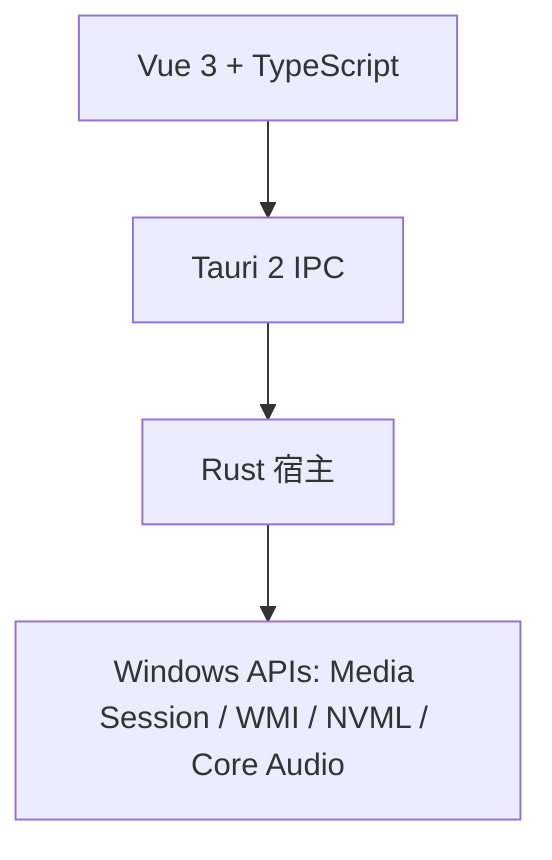

# Dynamic Island for Windows

**A native-feeling Dynamic Island for your Windows desktop.**

媒体、系统状态与快捷控制，安静地收进屏幕顶部的一枚灵动胶囊。

基于 Vue 3 + TypeScript + Tauri 2 + Rust 构建，兼顾视觉质感、流畅动画与低后台开销。

[**下载最新版本 →**](https://github.com/Hayden0226/Dynamic_Island_for_Windows/releases/latest) · [功能](#功能) · [安装](#安装) · [使用](#使用) · [从源码构建](#从源码构建)

<p align="center">
  <a href="https://github.com/Hayden0226/Dynamic_Island_for_Windows/releases/latest"></a>
  
  
</p>

## 界面预览


## 功能

- **全局媒体控制** — 查看封面、曲名、歌手与播放进度，并执行上一首、播放/暂停和下一首。
- **系统状态一屏掌握** — 查看 CPU 占用与温度、内存占用，以及 NVIDIA GPU 的占用与温度。
- **快捷调节** — 直接调整系统音量与支持的内置屏亮度，滑块读写真实系统状态。
- **克制的连贯动画** — 尺寸、内容缩放、透明度与位移沿统一时间线推进，没有无意义弹跳。
- **一致的视觉语言** — 收起与展开始终保持固定 `24 px` 连续曲率圆角，动画过程中不改变曲率。
- **真正的桌面集成** — 顶部置顶、无任务栏按钮、透明区域鼠标穿透、系统托盘与开机自启。
- **为长期常驻而设计** — 事件驱动更新，收起态尽量减少后台工作，只在需要时采集数据。

## 安装

### 系统要求

- Windows 10 版本 2004（Build 19041）及以上，或 Windows 11。
- 64 位 Windows。
- 安装与运行不需要管理员权限，也不需要 Node.js、Rust 或 Visual Studio。
- 支持多显示器与系统缩放，窗口居中于启动时的主显示器，命中区域会按当前 DPI 换算。
- CPU、内存和音量开箱即用；GPU 数据依赖 NVIDIA NVML，非 NVIDIA 显卡会回退为 `0%`。
- 亮度控制依赖笔记本内置屏的 `WmiMonitorBrightness` 接口，部分台式机与外接显示器不可用。

### 下载并安装

1. 打开 [最新版本](https://github.com/Hayden0226/Dynamic_Island_for_Windows/releases/latest) 页面。
2. 在 `Assets` 中下载 Windows x64 安装包。
3. 双击安装包，按向导完成安装；默认安装目录为 `%LOCALAPPDATA%\Dynamic Island`。
4. 安装程序会创建桌面快捷方式与开始菜单项，并将灵动岛放入系统托盘。
5. 安装结束后程序会自动启动，下次登录 Windows 时也会默认自动启动。

> 安装包尚未做代码签名。如果 Windows SmartScreen 提示「Windows 已保护你的电脑」，请先确认下载来源，再依次点击「更多信息」→「仍要运行」。对应版本的安装包大小与 SHA256 校验值见该版本的发布说明。

### 首次启动

安装完成后，灵动岛会出现在主显示器顶部中央，并保持置顶：

- 没有媒体播放时，收起态只显示时间，尺寸为 `104 x 48`。
- 有媒体播放时，收起态显示封面与时间，尺寸为 `176 x 48`。
- 鼠标进入可见胶囊后展开；无媒体时使用 `380 x 112` 紧凑面板，有媒体时使用 `380 x 220` 完整面板。
- 窗口透明区域不会拦截鼠标，也不会挡住下方窗口的点击。

如果启动后没有看到灵动岛：

1. 左键单击系统托盘中的灵动岛图标，重新唤出窗口。
2. 如果托盘图标被折叠，点击任务栏右下角的 `^` 展开隐藏图标区。
3. 仍然没有显示时，从开始菜单重新打开 Dynamic Island；单实例机制只会唤出已有窗口。

## 使用

### 基本交互

| 操作 | 效果 |
| --- | --- |
| 鼠标进入 | 展开面板 |
| 鼠标离开 | 约 140 ms 后自动收起 |
| 点击图钉 | 保持展开，忽略自动收起 |
| 播放 / 暂停按钮 | 控制 Windows 全局媒体会话 |
| 上一首 / 下一首 | 切换当前媒体会话的曲目 |
| 拖动亮度滑块 | 调整内置屏亮度 |
| 拖动音量滑块 | 调整系统输出音量 |
| 浏览系统状态 | 查看 CPU、内存、GPU 占用与可用温度 |

说明：

- 媒体信息来自 Windows 全局媒体会话，支持 Spotify、Edge、Chrome、系统播放器等常见来源。
- 若播放器没有向系统暴露媒体会话，封面、标题与控制按钮不会出现。
- GPU 温度需要 NVIDIA 显卡与可用的 NVML 驱动；其他显卡只显示占用回退值。
- 台式机外接显示器可能不支持亮度控制，此时滑块不会生效。
- 没有媒体播放时不会显示默认封面，展开态只保留系统状态与快捷控制。

### 托盘与开机自启

- 程序默认随 Windows 登录自动启动。
- 右键单击托盘图标，可勾选或取消「开机自启」，设置立即生效。
- 左键单击托盘图标，可重新显示灵动岛。
- 右键单击托盘图标 →「退出」，可完全退出程序。

灵动岛不显示任务栏按钮，日常退出请使用托盘菜单。

### 更新

1. 右键托盘图标，先退出正在运行的旧版本。
2. 打开 [Releases](https://github.com/Hayden0226/Dynamic_Island_for_Windows/releases/latest) 下载新版本并覆盖安装。
3. 安装目录、快捷方式和开机自启设置会保留，新版本会自动启动。
4. 如果开机自启仍指向旧路径，退出后在托盘菜单重新勾选一次「开机自启」即可。

### 卸载

1. 打开 Windows「设置 → 应用 → 已安装的应用」。
2. 找到 Dynamic Island，选择「卸载」。
3. 按提示完成卸载。

如果卸载后任务管理器仍显示失效的开机启动项，可在「任务管理器 → 启动应用」中将其禁用。

## 常见问题

**安装时提示未知发布者怎么办？**

安装包尚未做代码签名。确认下载来源、文件名和发布说明中的 SHA256 无误后，选择「更多信息」→「仍要运行」即可。

**为什么没有显示歌曲封面和标题？**

当前播放器没有向 Windows 暴露全局媒体会话。换用 Edge、Chrome、Spotify 或系统播放器通常可以正常显示。

**为什么 GPU 温度是空的？**

GPU 温度依赖 NVIDIA NVML。非 NVIDIA 显卡或驱动不可用时，只显示 GPU 占用。

**为什么亮度滑块没有效果？**

亮度控制依赖 `WmiMonitorBrightness`，台式机外接显示器、部分驱动或 HDR 模式可能不支持。

**为什么透明区域不会挡住下方窗口的鼠标？**

这是预期行为。窗口命中区域会跟随可见胶囊与面板收缩，透明区域全部穿透到底层窗口。

**重复双击图标会打开多个灵动岛吗？**

不会。程序使用单实例机制，重复启动只会唤出已有窗口。

## 技术架构



- **Vue 3 + TypeScript** 承载界面、动画系统、状态管理与设置。
- **Tauri 2 IPC** 建立明确的事件与权限边界，减少前后端耦合。
- **Rust + Windows API** 负责窗口管理、媒体会话、系统数据、亮度与音量控制。
- **连续曲率几何** 在渲染层统一生成，确保收起、展开与动画中间态保持同一套圆角。

### 项目结构

```text
island-app/
  src/                      Vue 3 + TypeScript 界面、动画、状态与 IPC
    components/             灵动岛表面与交互控件
    core/                   动画器、缓动、squircle 几何、指标与 IPC
    store/                  全局状态与事件订阅
  src-tauri/                Tauri 2 + Rust 宿主
    src/lib.rs              窗口管理、媒体会话、系统数据、亮度与音量
    tauri.conf.json         窗口与安全配置
  build.ps1                 构建与开发入口
```

### 动画系统

所有结构动画由 `src/core/animator.ts` 统一调度，尺寸、内容缩放、透明度与位移沿同一条时间线推进。

| 动画 | 行为 |
| --- | --- |
| 展开尺寸 | 240 ms，无过冲 S 形缓动 |
| 收起触发 | 鼠标离开约 140 ms 后开始 |
| 收起尺寸 | 260 ms，无过冲 S 形缓动 |
| 内容显现 | 与展开同步放大，自上而下淡入，约 180 ms |
| 收起内容退场 | 约 78 ms 淡出，再继续收缩表面 |

圆角使用固定 `24 px` 半径与 `CornerSmoothing = 0.6` 的连续曲率几何。收起、展开和中间态共用同一套几何，动画过程中不会切换圆角样式。

### 后台开销策略

- 收起态每 3 秒轻量检查一次媒体会话，停止播放后封面会自动消失；系统数据仍不轮询。
- 展开态每 2 秒检查媒体与系统数据，仅有变化时才推送到界面。
- 媒体信息优先依赖系统媒体会话事件，而不是持续查询播放器。
- UI 只更新发生变化的数据，避免整块界面反复重绘。

### 可靠性

- 单实例互斥，重复启动只会唤出已有窗口。
- 安装版常驻系统托盘，并默认随 Windows 登录自动启动。
- 原生窗口尺寸跟随可见表面收缩，透明区域不会拦截鼠标点击。
- 全屏应用期间隐藏窗口并取消置顶，退出全屏后重新定位。
- 处理显示器切换、DPI 变化与休眠唤醒。
- 媒体会话失效后自动重启监听，不阻塞 UI 线程。

## 从源码构建

### 环境要求

- Windows 10 版本 2004（Build 19041）或更高。
- Node.js 18+。
- Rust 工具链。
- Visual Studio Build Tools，包含「使用 C++ 的桌面开发」与 Windows SDK。

### 构建安装包

```powershell
git clone https://github.com/Hayden0226/Dynamic_Island_for_Windows.git
cd Dynamic_Island_for_Windows\island-app
npm install
powershell -ExecutionPolicy Bypass -File .\build.ps1
```

构建产物：

```text
island-app\src-tauri\target\release\dynamic-island-windows.exe
island-app\src-tauri\target\release\bundle\nsis\
```

`bundle\nsis\` 中的安装包可直接分发，安装后常驻系统托盘并默认开机自启。

### 开发模式

带热更新启动桌面应用，终端需保持打开：

```powershell
powershell -ExecutionPolicy Bypass -File .\build.ps1 dev
```

仅在浏览器中进行视觉与交互调试：

```powershell
npm run dev
```

浏览器 mock 模式不会启动桌面浮层，也不会读取真实的媒体会话或系统状态。

## 已知限制

- 媒体控制依赖 Windows 全局媒体会话，应用未暴露会话时不可用。
- CPU / GPU 温度为轻量展示数据，不是完整硬件监控面板。
- 亮度控制依赖 `WmiMonitorBrightness` 接口，台式机外接显示器可能不可用。
- 通知聚合目前为内置演示，尚未接入完整的系统通知与插件体系。
- GPU 温度需要 NVIDIA 显卡与可用的 NVML 驱动。

## Roadmap

- 完善通知聚合与插件扩展能力。
- 增加更多系统控制项与可配置外观。
- 持续改善多显示器、DPI、休眠唤醒和复杂外设环境下的稳定性。
- 继续降低收起态唤醒频率与长时运行资源占用。

## 反馈与贡献

遇到问题时，请先确认系统版本、显示环境和播放器类型，再通过 [Issues](https://github.com/Hayden0226/Dynamic_Island_for_Windows/issues) 提交可复现步骤。

欢迎提交 Pull Request；涉及界面或动画的改动，请附上修改前后的截图或录屏。

## 许可证

仓库目前尚未附带 `LICENSE` 文件；在许可证明确前，请先联系作者确认转载与再分发范围。
